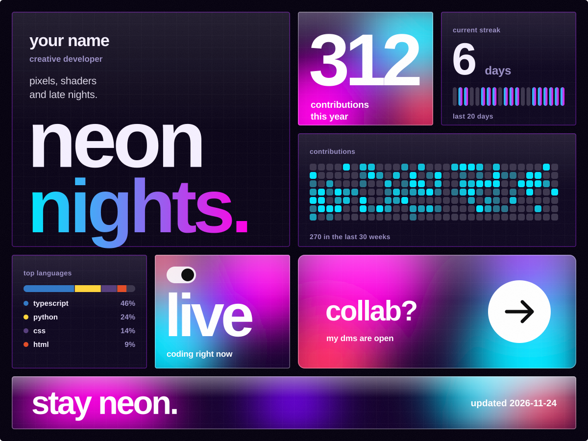
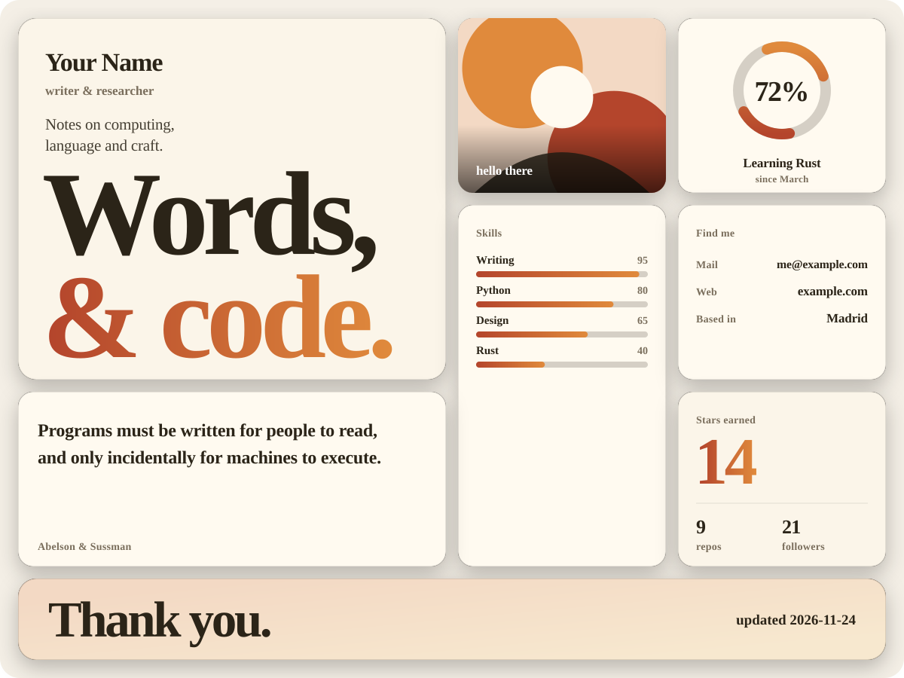

<div align="center">


# readme-bento

**Un bento-grid para tu perfil de GitHub que configuras en un solo archivo y que se actualiza solo cada día.**

[English](README.md) · [Español](README.es.md) · [Referencia de configuración](docs/configuration.md)

</div>

---

## Por qué

Los bento READMEs quedan genial, pero hacer uno implica editar un SVG a mano, y los números se quedan desfasados al día siguiente. **readme-bento** lo convierte en un archivo de configuración:

- **Un solo archivo.** Eliges tarjetas, tamaños y colores en `bento.yml`; el layout se hace solo.
- **Datos en vivo.** Contribuciones, racha, último commit, lenguajes, estrellas y líneas de código, refrescados a diario por una GitHub Action.
- **Nada que alojar.** Se ejecuta en *tu* repo y escribe un SVG estático. Sin servidor, sin servicios de terceros, sin límites de uso.
- **Solo las tarjetas.** La imagen tiene el fondo transparente, así que se integra en cualquier README. Pon un fondo sólido o degradado detrás solo si quieres.
- **Hazlo tuyo.** 15 temas, 25 paletas, tus propios colores, fuentes, esquinas, sombras, grano y texturas. Cada tarjeta puede cambiar su fondo, color de texto y radio. Mira [Hazlo tuyo](#hazlo-tuyo).
- **Claro, oscuro o ambos.** Con `theme: auto` (o cualquier par, como `[nord, solarized-light]`) sigue el tema de GitHub de quien te visita.
- **Seguro.** El SVG lleva su propia fuente, sin scripts ni peticiones externas, y todo el texto va escapado.

## Empezar

Elige el camino que más te convenga. Los tres dan el mismo resultado.

### A. Sin código: el configurador web

Abre **[amehara.github.io/readme-bento](https://amehara.github.io/readme-bento/)**, elige un estilo de partida, cambia tema, colores y tarjetas con el formulario y mira la vista previa actualizarse en directo. Al final te da cinco pasos cortos con botones que abren GitHub con cada archivo ya rellenado. Funciona entero en tu navegador.

### B. Un solo archivo, cero configuración

Añade solo el workflow de abajo a tu repositorio de perfil, **sin `bento.yml`**. readme-bento crea entonces un bento a partir de tu perfil de GitHub (nombre, bio, ubicación, contribuciones, lenguajes, repos destacados). Añade un `bento.yml` más adelante cuando quieras personalizarlo. En local: `python -m bento init --zero`.

### C. Control total: escribe `bento.yml`

Necesitas tu repositorio de perfil: un repo público con exactamente tu nombre de usuario (`github.com/<tú>/<tú>`).

**1. Añade tu configuración.** Crea `bento.yml` en ese repo. Parte de uno de los ejemplos ([designer](examples/designer.yml), [developer](examples/developer.yml), [minimal](examples/minimal.yml)) y cambia `github.user` y los textos.

**2. Añade el workflow** (es el único archivo que necesita el camino B). Crea `.github/workflows/bento.yml`:

```yaml
name: update bento

on:
  schedule:
    - cron: "17 4 * * *"   # cada día a las 04:17 UTC
  workflow_dispatch:         # para ejecutarlo a mano
  push:
    branches: [main]
    paths: ["bento.yml"]

permissions:
  contents: write

jobs:
  bento:
    runs-on: ubuntu-latest
    steps:
      - uses: actions/checkout@v4
      - uses: amehara/readme-bento@v1
```

**3. Ejecútalo y muéstralo.** Ve a la pestaña **Actions** → *update bento* → **Run workflow**. Al terminar aparece `bento.svg` en tu repo. Añádelo a tu `README.md`:

```html

```

Listo. A partir de ahora se refresca a diario y cada vez que editas `bento.yml`.

> **Consejo:** con `theme: auto` se generan `bento-dark.svg` y `bento-light.svg` y el log del workflow imprime el bloque `<picture>` para pegar.

## Un vistazo a la configuración

```yaml
github:
  user: octocat
theme: dark            # dark | light | auto

cards:
  - type: hero
    size: 2x2
    title: octocat
    subtitle: desarrollador
    headline: [ship, daily.]

  - type: number       # un número grande de tus datos de GitHub...
    source: contributions
    label: [contribuciones, este año]
    color: ocean

  - type: number       # ...o cualquier texto
    value: "5+"
    label: años de experiencia
    color: sunset

  - type: streak
  - type: commit       # tu último commit público
  - type: stack
    items: [typescript, react, docker]
```

Los textos pueden usar tu perfil de GitHub: `title: "{name}"`, `body: "{bio|texto si está vacío}"`, además de `{login}`, `{first_name}`, `{location}`, `{company}` y `{blog}`. Ponlos entre comillas para que YAML conserve las llaves.

Las tarjetas se colocan en una rejilla de 4 columnas en el orden en que las listas, y las pequeñas rellenan los huecos. Consulta la [referencia completa](docs/configuration.md) para ver todas las tarjetas, tamaños, colores y opciones.

## Tarjetas disponibles

`hero` (nombre y titular gigante) · `number` (cualquier número o palabra grande) · `streak` (racha) · `heatmap` (calendario de contribuciones) · `commit` (último commit público) · `languages` (lenguajes) · `repos` (repos con más estrellas) · `stack` (chips de tecnologías) · `status` (interruptor con una palabra) · `ring` (anillo de progreso) · `bars` (barras de habilidades) · `text` (texto libre o cita) · `contact` (pares etiqueta/valor) · `image` (una imagen de tu repo) · `cta` (llamada a la acción) · `band` (banda final).

## Hazlo tuyo

Todo el aspecto es configurable, de forma global o por tarjeta:

```yaml
theme: [dracula, solarized-light]   # 15 incluidos, o define los tuyos

style:
  corners: soft          # round | soft | sharp | cualquier número de píxeles
  shadow: true
  grain: 0.1             # grano de película
  pattern: dots          # dots | grid | lines | grain
  font: serif            # sora | system | serif | mono
  text_case: lower       # keep | lower | upper
  gap: 12
  background: [ "#12002b", "#000000" ]

cards:
  - type: stack
    items: [python, rust]
    bg: ["#ff9a9e", "#a18cd1"]   # cualquier tarjeta puede tener su color, degradado o paleta
    radius: 8                     # y sus propias esquinas, borde, textura...
```

El color del texto se elige solo para que se lea bien sobre cualquier fondo. Mira la [galería de temas y paletas](docs/themes.md) y la [referencia de configuración](docs/configuration.md#style).

## Ejemplos

Cada uno es una configuración lista para copiar en [`examples/`](examples/): [`neon`](examples/neon.yml) (tema propio, esquinas rectas, grano), [`editorial`](examples/editorial.yml) (serif y papel), [`terminal`](examples/terminal.yml) (monoespaciada), [`pastel`](examples/pastel.yml) (par claro/oscuro), [`designer`](examples/designer.yml), [`developer`](examples/developer.yml) y [`minimal`](examples/minimal.yml). Pruébalos con `python -m bento build -c examples/neon.yml --demo` o créalos con `python -m bento init --template neon`.

 

## Repos y contribuciones privadas

Por defecto solo se cuentan datos **públicos**. Para incluir repos y contribuciones privadas, crea un [token de acceso personal](https://github.com/settings/tokens) con los permisos `repo` y `read:user`, guárdalo como secreto del repositorio llamado `STATS_TOKEN` y pásalo a la action:

```yaml
      - uses: amehara/readme-bento@v1
        with:
          token: ${{ secrets.STATS_TOKEN }}
```

Al SVG solo llegan los *números*; los nombres de repositorios privados nunca se escriben en él.

## Previsualizar en local

Puedes diseñar tu bento sin subir nada. Necesitas Python 3.10+ y `pip install pyyaml`:

```bash
git clone https://github.com/amehara/readme-bento && cd readme-bento
python -m bento build -c ruta/a/tu/bento.yml --demo   # datos de ejemplo, sin red
python -m bento validate -c ruta/a/tu/bento.yml        # comprueba la config
python -m bento init --user <tú> --template developer  # genera config + workflow
```

Abre el `.svg` generado en el navegador. `--demo` usa números de ejemplo; sin él se descargan tus estadísticas reales (define `GITHUB_TOKEN` para evitar el límite anónimo).

## Preguntas frecuentes

**El SVG no se actualiza.** Revisa la pestaña *Actions* y comprueba que los workflows tienen permiso de escritura (Settings → Actions → General → *Workflow permissions* → Read and write). GitHub también pausa los workflows programados tras 60 días sin actividad en el repo; si ocurre, reactívalo desde la pestaña Actions y ejecútalo a mano.

**¿Puedo hacer tarjetas clicables?** Un SVG mostrado con `` no puede llevar enlaces. Pon enlaces Markdown normales debajo de la imagen.

**¿Puedo usar mis propios colores?** Sí: define tus propios temas, paletas y degradados en `bento.yml`, o usa `bg` y `fg` en cualquier tarjeta. Mira [Temas](docs/configuration.md#themes) y [Colores](docs/configuration.md#colors).

**¿La fuente se descarga de internet?** No. [Sora](https://github.com/sora-xor/sora-font) (SIL OFL) va incrustada en el SVG, así que se ve igual en todas partes, también dentro de GitHub.

## Licencia

MIT para el código. La fuente Sora incrustada está bajo la [SIL Open Font License](bento/data/fonts/OFL-Sora.txt).
