<div align="center">


# readme-bento

**A bento-grid for your GitHub profile that you configure in one file and that updates itself every day.**

[English](README.md) · [Español](README.es.md) · [Configuration reference](docs/configuration.md)

</div>

---

## Why

Bento READMEs look great, but making one means hand-editing an SVG, and the numbers go stale the day after you publish. **readme-bento** turns it into a config file:

- **One file to edit.** Pick cards, sizes and colors in `bento.yml`; the layout is done for you.
- **Live data.** Contributions, streak, latest commit, top languages, stars, lines of code. Refreshed daily by a GitHub Action.
- **Nothing to host.** It runs in *your* repo and writes a static SVG. No server, no third-party service, no rate limits.
- **Light, dark or both.** `theme: auto` follows your visitors' GitHub theme.
- **Safe by default.** The SVG embeds its own font, has no scripts or external requests, and every text is escaped.

## Quick start (3 minutes)

You need your profile repository: a public repo named exactly like your username (`github.com/<you>/<you>`).

**1. Add your config.** Create `bento.yml` in that repo. Start from one of the examples ([designer](examples/designer.yml), [developer](examples/developer.yml), [minimal](examples/minimal.yml)) and change `github.user` and the texts.

**2. Add the workflow.** Create `.github/workflows/bento.yml`:

```yaml
name: update bento

on:
  schedule:
    - cron: "17 4 * * *"   # every day at 04:17 UTC
  workflow_dispatch:         # lets you run it by hand
  push:
    branches: [main]
    paths: ["bento.yml"]

permissions:
  contents: write

jobs:
  bento:
    runs-on: ubuntu-latest
    steps:
      - uses: actions/checkout@v4
      - uses: amehara/readme-bento@v1
```

**3. Run it and show it.** Open the **Actions** tab → *update bento* → **Run workflow**. When it finishes, `bento.svg` appears in your repo. Add it to your `README.md`:

```html

```

That's it. From now on it refreshes itself daily and whenever you edit `bento.yml`.

> **Tip:** with `theme: auto` the build writes `bento-dark.svg` and `bento-light.svg` and prints the `<picture>` snippet to paste (see the workflow log).

## A taste of the config

```yaml
github:
  user: octocat
theme: dark            # dark | light | auto

cards:
  - type: hero
    size: 2x2
    title: octocat
    subtitle: developer
    headline: [ship, daily.]

  - type: number       # a big number from your GitHub data...
    source: contributions
    label: [contributions, this year]
    color: ocean

  - type: number       # ...or any text you like
    value: "5+"
    label: years of experience
    color: sunset

  - type: streak
  - type: commit       # your latest public commit
  - type: stack
    items: [typescript, react, docker]
```

Cards are placed on a 4-column grid in the order you list them, and small cards fill any gaps. See the [full reference](docs/configuration.md) for every card, size, color and option.

| Card | What it shows |
| --- | --- |
| `hero` | Name, role, intro and a giant two-line headline |
| `number` | Any big number or word: from GitHub data or typed by hand; `mesh`, `outline` and `plain` styles |
| `streak` | Current contribution streak and the last 20 days |
| `commit` | Your latest public commit, with a live dot |
| `status` | A toggle with a big word ("on", "open"…) |
| `stack` | Tech chips with brand colors |
| `languages` | Your top languages as a bar |
| `cta` | A call to action with an arrow |
| `band` | A slim footer band with the last update date |

## Examples

| Developer (`theme: auto`) | Minimal |
| --- | --- |
|  |  |

## Private repositories and contributions

By default only **public** data is counted. To include private repos and private contributions, create a [personal access token](https://github.com/settings/tokens) with the `repo` and `read:user` scopes, save it as a repository secret named `STATS_TOKEN`, and pass it to the action:

```yaml
      - uses: amehara/readme-bento@v1
        with:
          token: ${{ secrets.STATS_TOKEN }}
```

Only the *numbers* end up in the SVG. Repository names are never written to it.

## Preview locally

You can design your bento without pushing anything. You need Python 3.9+ and `pip install pyyaml`:

```bash
git clone https://github.com/amehara/readme-bento && cd readme-bento
python -m bento build -c path/to/your/bento.yml --demo   # sample data, no network
python -m bento validate -c path/to/your/bento.yml        # check the config
python -m bento init --user <you> --template developer    # scaffold config + workflow
```

Open the generated `.svg` in a browser. `--demo` uses sample numbers; without it the build fetches your real stats (set `GITHUB_TOKEN` to avoid the anonymous rate limit).

## FAQ

**The SVG doesn't update.** Check the *Actions* tab for errors, and make sure workflows have write access (Settings → Actions → General → *Workflow permissions* → Read and write). GitHub also pauses scheduled workflows after 60 days without repository activity; if that ever happens, re-enable it from the Actions tab and run it manually.

**Can I make cards clickable?** SVGs shown through `` can't contain links. Put regular Markdown links under the image, as in the sample README of the designer example.

**Can I use my own colors?** Yes, define a palette in `bento.yml`. See [Custom palettes](docs/configuration.md#custom-palettes).

**Is the font loaded from the internet?** No. [Sora](https://github.com/sora-xor/sora-font) (SIL OFL) is embedded in the SVG, so it renders the same everywhere, including inside GitHub.

## Roadmap

- A web configurator with live preview that exports `bento.yml`
- More cards: weekly activity heatmap, pinned repos, social links, now-playing
- Custom fonts and an emoji-friendly text mode

Ideas and pull requests are welcome. Run `python -m unittest discover -s tests` before opening one.

## License

MIT for the code. The embedded Sora font is under the [SIL Open Font License](bento/data/fonts/OFL-Sora.txt).
