# Themes and palettes

How to use them: set `theme:` in your `bento.yml`, or `color:` on a card. See the [configuration reference](configuration.md#themes) for custom themes and palettes.

## Themes

Every image below is the same layout rendered with a different `theme`.

| | |
| --- | --- |
| **dark** `dark`<br>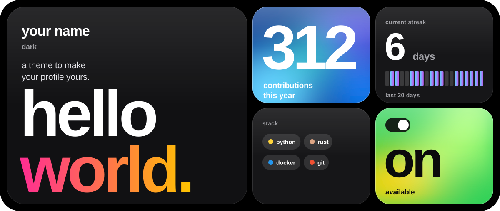 | **light** `light`<br>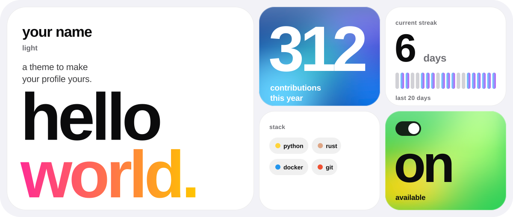 |
| **midnight**<br>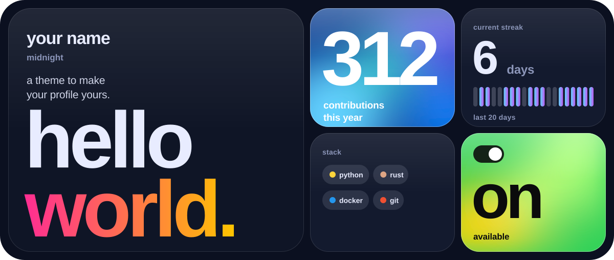 | **nord**<br>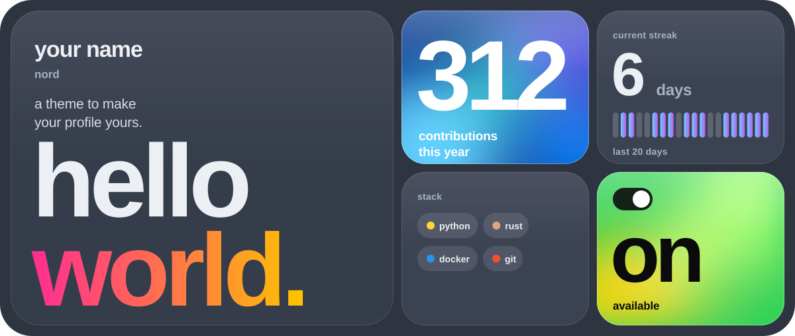 |
| **dracula**<br>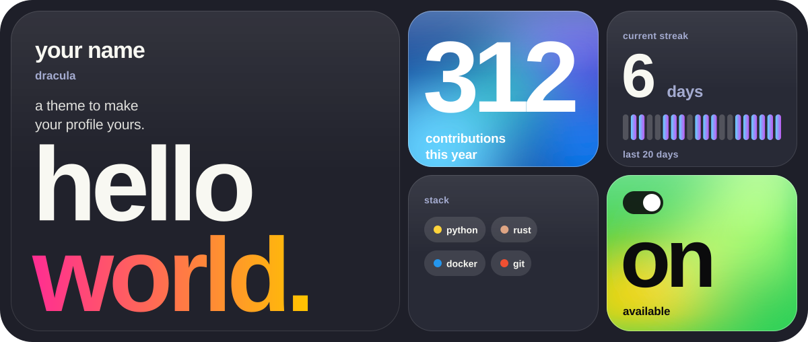 | **rose-pine**<br> |
| **catppuccin-mocha**<br> | **catppuccin-latte**<br>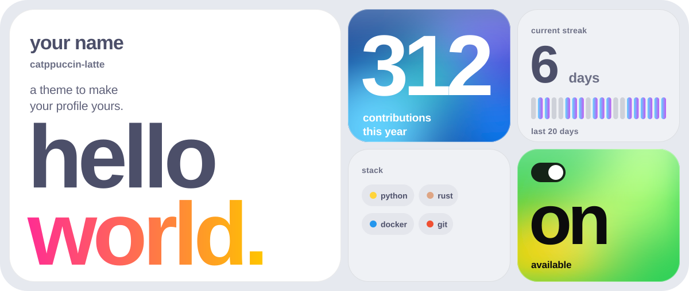 |
| **solarized-dark**<br>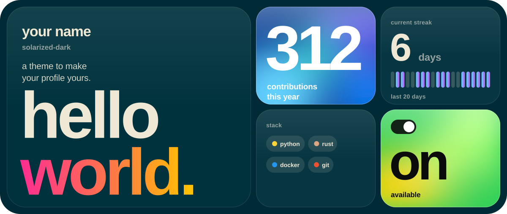 | **solarized-light**<br>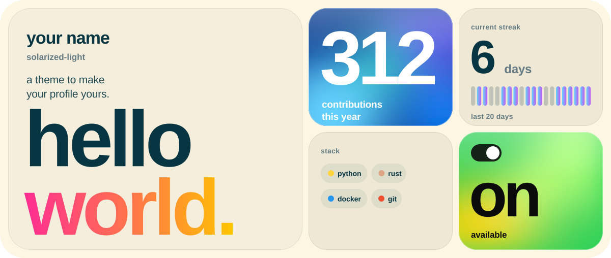 |
| **github-dark**<br>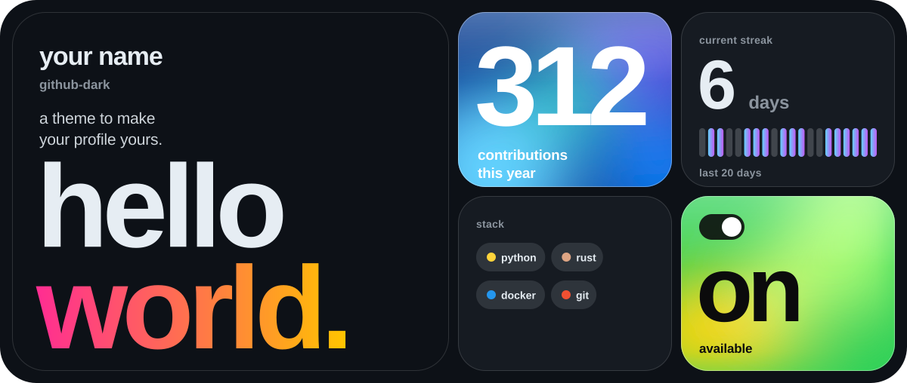 | **github-light**<br>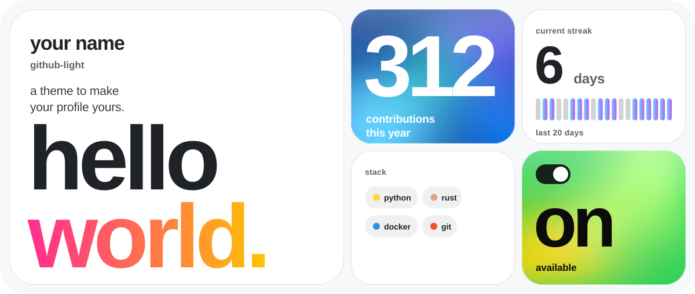 |
| **paper**<br>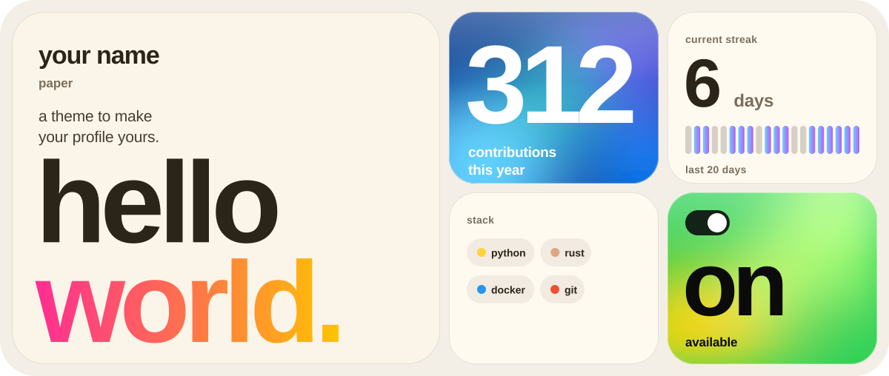 | **brutalist**<br> |
| **terminal**<br>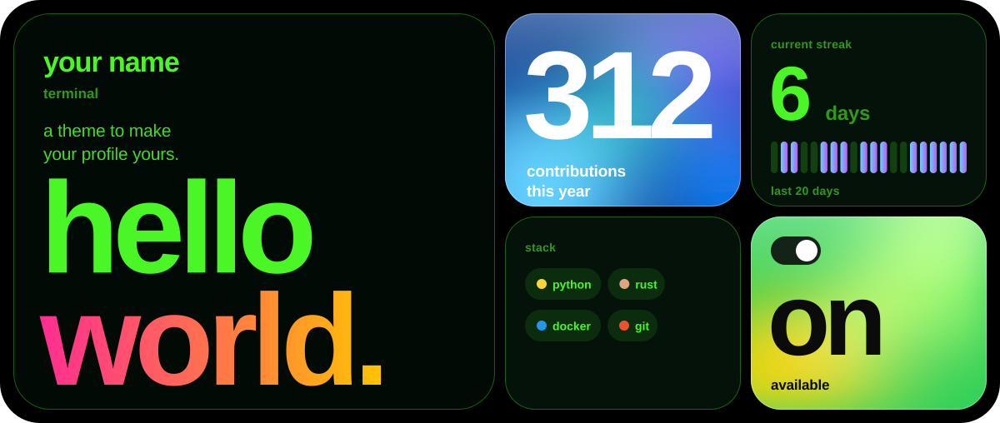 | |

Pair a dark and a light theme so your profile follows each visitor's GitHub appearance: `theme: [nord, solarized-light]`.

## Palettes

`color: <name>` on a card (or `bg: <name>`) gives it one of these mesh gradients. The text color is picked for contrast automatically.

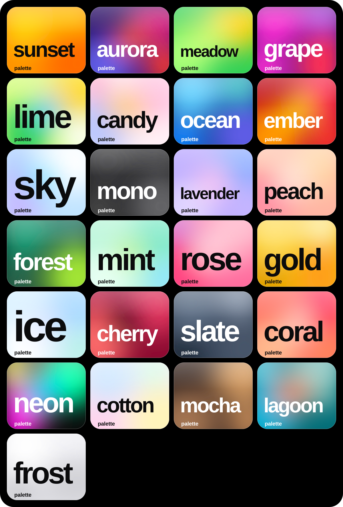

## Regenerate these images

```bash
python tools/build_gallery.py
```
